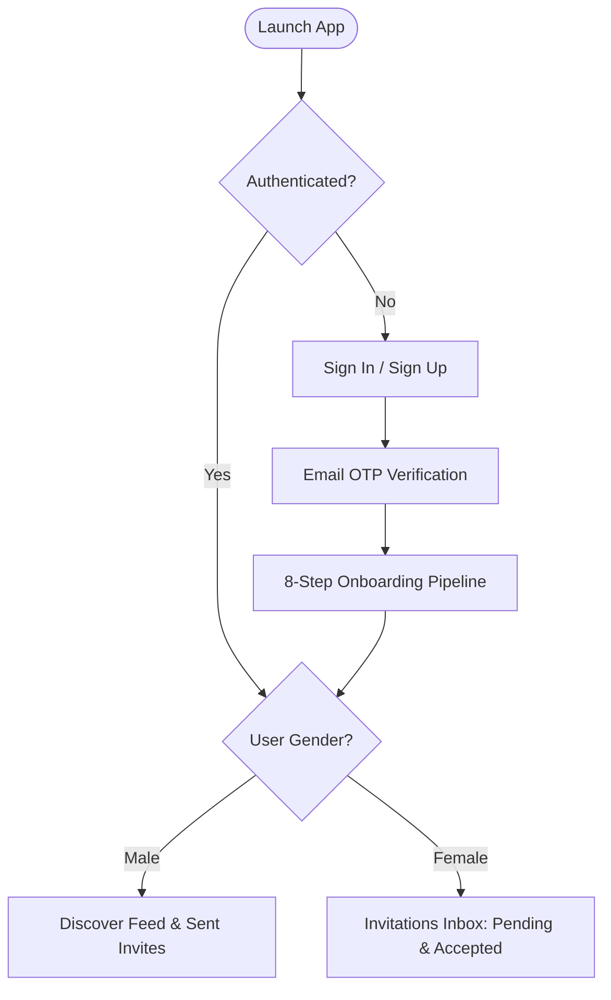
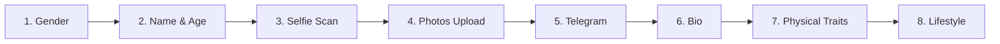
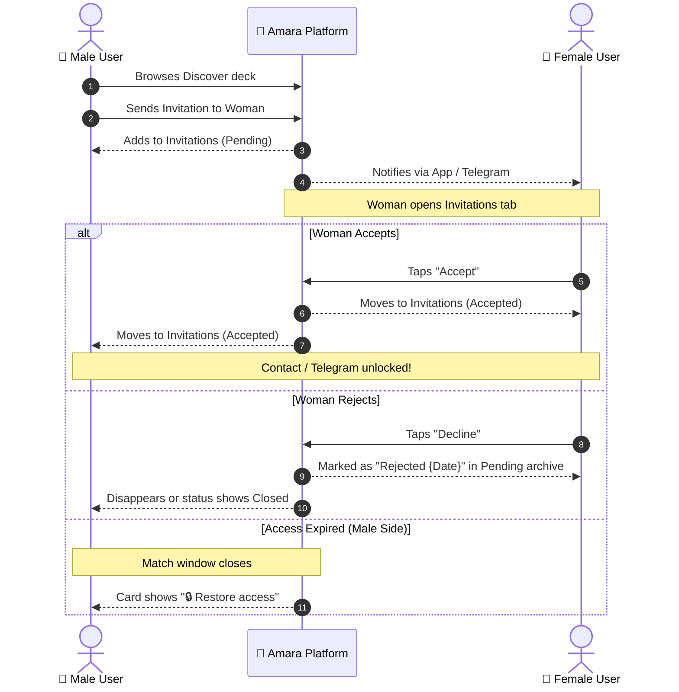

# Amara Dating Application — Master Product & Technical Documentation

---

## 1. Executive Overview & Product Philosophy

The **Amara Dating Application** is a specialized, chivalry-inspired dating platform designed on the **"approach-first"** model (popularized by platforms like Glambu). Unlike conventional mutual-swipe dating apps (such as Tinder or Bumble), Amara shifts the dynamics to prioritize intentionality, safety, and curated interactions.

### 1.1 Core Principles
1. **Approach-First Dynamics (Gender Asymmetry)**:
   - **Men** browse curated female profiles in a discovery deck and take the initiative by sending formal dating invitations.
   - **Women** do not browse cold profiles or get spammed by mass swipe decks; they receive incoming invitations in a personal inbox and decide whether to accept or decline.
2. **Liveness & Safety Verification**:
   - Zero tolerance for catfishing, bots, or stolen pictures.
   - Real-time biometric oval face-scan liveness detection combined with automated face detection on uploaded profile photos (minimum 3 photos with at least 1 clear face detected).
3. **Frictionless External Connectivity (Telegram Handoff)**:
   - Built-in Telegram bot integration allows users to receive immediate notifications when invites are sent or accepted, and provides direct communication channels upon mutual approval.
4. **Curated & Safe Community Standards**:
   - Strict 18+ age verification, zero nudity policy, granular lifestyle definitions, and a 30-day grace period for account deletion recovery.

---

## 2. Information Architecture & Navigation

The platform features a distinct navigation architecture split by user gender to enforce the approach-first philosophy.

```
                          ┌────────────────────────┐
                          │   Amara Dating App     │
                          └───────────┬────────────┘
                                      │
            ┌─────────────────────────┴─────────────────────────┐
            ▼                                                   ▼
┌───────────────────────┐                           ┌───────────────────────┐
│     👨 Male Flow       │                           │    👩 Female Flow     │
└───────────┬───────────┘                           └───────────┬───────────┘
            │                                                   │
  ┌─────────┼─────────┬─────────┐                     ┌─────────┼─────────┬─────────┐
  ▼         ▼         ▼         ▼                     ▼         ▼         ▼         ▼
Discover  Invites  About Me  Settings              Invites  Telegram  About Me  Settings
 (Browse)  (Status) (Profile) (Prefs)              (Inbox)   (Bot)    (Profile) (Prefs)
```

### 2.1 Tab Bar Navigation Matrix

| Tab Name | Male Account | Female Account | Purpose |
| :--- | :---: | :---: | :--- |
| **Discover** (`/discover`) | ✅ **Active** | ❌ **Hidden** | Browsing female profiles, viewing details, and sending invitations. |
| **Invitations** (`/invitations`) | ✅ **Active** | ✅ **Active** | **Men:** Tracks sent invitations (`Pending` / `Accepted`).<br>**Women:** Primary home inbox receiving men's invitations. |
| **Telegram** (`/telegram`) | Accessible in Settings | ✅ **Tab Item** | Direct status, bot pairing, and notification management. |
| **About Me** (`/about-me`) | ✅ **Active** | ✅ **Active** | Quick profile lifestyle traits, photos, and intent overview. |
| **Settings / Profile** (`/settings`) | ✅ **Active** | ✅ **Active** | Profile editing, preferences, language, theming, and account lifecycle. |

---

## 3. End-to-End User Journeys & Screen Specifications



---

### Module 1: Authentication & Security

#### 1.1 Login Screen (`LoginScreen.tsx`)
- **Key Inputs**:
  - Email address (with live format validation).
  - Password (with eye toggle for show/hide plain text).
- **Secondary Actions**:
  - Language selector modal / dropdown (supporting 11 languages).
  - "Forgot Password?" recovery flow.
  - "Don't have an account? Sign up" toggle.
  - Terms of Service & Privacy Policy footer links.

#### 1.2 Registration Screen (`RegisterScreen.tsx`)
- **Key Inputs**:
  - Email address.
  - New secure password.
  - Inline language preference selector.
- **Submission Action**:
  - "Next" / "Submit" button with activity loading spinner.
  - Transitions directly to OTP verification upon successful payload creation.

#### 1.3 6-Digit Email OTP Verification (`OTPScreen.tsx`)
- **UI Components**:
  - Subtitle displaying masked recipient email: *"We sent a 6-digit code to user@example.com"*.
  - 6 individual, auto-advancing numeric input cells.
  - Resend OTP countdown timer (30-second throttle before re-requesting).
  - "Change Email" action link (returns to registration to correct typos).
- **Backend Flow**:
  - `POST /api/v1/auth/verify-otp` with payload `{ email, otp }`.
  - On 200 OK: Returns JWT access/refresh token and routes to either Onboarding Step 1 (if profile incomplete) or Main Dashboard.

---

### Module 2: The 8-Step Onboarding Pipeline

Users must complete an 8-step wizard before entering the platform. Progress is tracked step-by-step.



#### Step 1: Gender & Orientation (`GenderOrientationScreen.tsx`)
- **Selection Options**:
  - `Man like women` (Male targeting women)
  - `Woman like men` (Female targeting men)
  - `LGBTQ+`
- **Data Privacy Disclaimer**:
  - *"We value your privacy. Your orientation preferences are used exclusively to match you with compatible people and are never publicly broadcast."*

#### Step 2: Name & Birthday Verification (`DOBScreen.tsx`)
- **Display Name**: First name or nickname field (max 30 characters).
- **Date of Birth**:
  - Date inputs: `DD / MM / YYYY`.
  - Strict Client & Server 18+ validation: Underage dates immediately trigger validation error *"You must be at least 18 years old to join"*.

#### Step 3: Biometric Liveness / Selfie Scan (`SelfieVerificationScreen.tsx`)
- **Phase A (Camera Prompt)**: Live camera feed with top banner instruction: *"Move face in front of camera"*.
- **Phase B (Viewfinder Alignment)**: Translucent dark backdrop with centered oval face viewfinder overlay and active **"Start"** scan trigger.
- **Phase C (Liveness Analysis)**:
  - Progress indicator displaying real-time processing status (*"Initializing face verification... 75%"*).
  - Computes 3D face mesh / liveness checks to prevent static photo or screen spoofing.
  - Stores biometric verification badge: `is_verified = true`.

#### Step 4: Photo Upload & Automated Face Validation (`UploadImageScreen.tsx`)
- **Photo Grid Requirements**:
  - 6 upload slots (2 rows of 3).
  - **Minimum requirement**: 3 approved photos.
  - **Safety Policy**: Prominent *"No nudity"* warning banner.
- **Automated Face Detection Gatekeeper**:
  - Scans every uploaded photo using face detection AI/ML.
  - If fewer than 1 photo contains a clearly recognizable face:
    - Displays red alert: *"None of your photos clearly shows your face. Please upload at least one photo where your face is visible."*
    - Individual delete/replace buttons on each slot.
    - **"Next"** button remains disabled until at least 1 clear face photo is validated.

#### Step 5: Telegram Integration (`ConnectTelegramScreen.tsx`)
- **Purpose**: Bridge app notifications and post-approval communication into Telegram.
- **UI Components**:
  - Heading: *"Connect your Telegram (optional)"*.
  - Subtitle: *"Get instant notifications when someone invites you or accepts your invitation."*
  - Action Button: **"Connect via Telegram Bot"** (deep-links to official Telegram bot `@AmaraDatingBot?start=TOKEN`).
  - Connection indicator: *"Status: Not connected"* / *"Status: Connected (@username)"*.
  - Option to skip and proceed to Step 6.

#### Step 6: Bio & Personal Statement (`AboutProfileScreen.tsx`)
- **Prompt**: *"Who are you, and what makes you great company?"*
- **Constraints**: Multi-line text area with live character counter (`0 / 150` characters max).
- Encourages concise, high-signal personal introductions.

#### Step 7: Physical Traits & Languages (`MoreDetailsScreen.tsx`)
- **Height**: Interactive horizontal slider ranging from 140 cm to 220 cm.
- **Body Type**: Single-choice chip selectors (*Slim*, *Athletic*, *Average*, *Curvy*, *Muscular*).
- **Appearance Rating / Style**: Aesthetic self-descriptor chips (*Casual*, *Chic*, *Trendy*, *Sporty*, *Elegant*).
- **Languages Spoken**: Multi-select pills (*English*, *Spanish*, *French*, *German*, *Italian*, *Russian*, *Arabic*, *Hindi*, etc.).

#### Step 8: Lifestyle Attributes & Relationship Intent (`MoreInfoScreen.tsx`)
- **Smoking Habits**: `[ Yes ]`, `[ No ]`, `[ Sometimes ]`.
- **Children**: `[ 0 ]`, `[ 1 ]`, `[ 2 ]`, `[ 3+ ]`, `[ Prefer not to say ]`.
- **Relationship Goal / Intent**:
  - `Hookup`
  - `Casual dating`
  - `Online relationship`
  - `Relationship`
  - `Marriage`
- **Submission**: Finalizes onboarding and activates user profile in the database.

---

### Module 3: Matching & Invitations Architecture

The core of Amara is the **asymmetric invitation protocol**.



#### 3.1 The Female Perspective (`InvitationsScreen.tsx` - Female)
- **Zero Cold Browsing**: Women do not see a Discover tab.
- **Footer Notice**: *"You only see men who invite you. At Glambu men approach you first, just like the old days."*
- **Sub-Tabs**:
  1. **Pending**:
     - Lists all incoming invitations awaiting response.
     - Displays avatar, name, age, invitation date, and rejection records (e.g. *"Rudera — Rejected 12 Apr, 2026"*).
     - Allows searching incoming invitations by name.
     - Bulk actions: "Select" button to manage/clear multiple records.
  2. **Accepted**:
     - Lists all accepted suitors.
     - Empty state illustration (clean envelope) with text: *"You have no accepted invitations yet. You will receive new invitations soon!"*.

#### 3.2 The Male Perspective (`InvitationsScreen.tsx` - Male)
- **Sub-Tabs**:
  1. **Pending**:
     - Lists all invitations sent by the man that are awaiting the woman's decision.
  2. **Accepted**:
     - Lists all connections accepted by women.
     - Badge shows pending/active counts (`9+`).
     - Includes card with avatar, name, age, timestamp (e.g. *"Vaani, 28 — 1 year ago"*).
     - **Access Gating**: If the connection access window expires or requires membership, displays the red **"🔒 Restore access"** button.

---

### Module 4: Settings, Preferences & Account Lifecycle

#### 4.1 Settings Navigation Tree (`SettingsScreen.tsx`)
```
Settings
├── Account
│   ├── My Profile             ── Full public preview
│   ├── Edit Profile           ── Photos, bio, physical traits
│   ├── About me               ── Lifestyle & intent (Smoking, Kids, Looking for)
│   ├── Telegram               ── Bot link & status
│   └── Preferences            ── Language, notifications, theme
├── Support & Legal
│   ├── How To Use Glambu      ── Onboarding guide & rules
│   ├── Privacy Policy         ── In-app legal text
│   ├── Terms and Conditions   ── Service agreement
│   └── Chat With Us           ── Customer support desk
└── Account Lifecycle
    ├── Log Out                ── Session termination
    └── Delete My Profile      ── 30-day soft deletion modal
```

#### 4.2 Preferences Screen (`PreferencesScreen.tsx`)
- **Language Selector**: Modal list supporting 11 major global languages.
- **Email Notifications**: Switch toggle for digest and invitation alerts.
- **Appearance (Theming Engine)**:
  - Three distinct modes: `Light`, `System`, `Dark`.
  - Dynamically updates the global theme context across all components, headers, backgrounds, and cards.

#### 4.3 Account Deletion & Recovery Policy (`DeleteAccountModal.tsx`)
- **Safety & Retention Policy**:
  - Destructive action labeled with warning prompt.
  - Dialog Text: *"Your profile will be hidden immediately and permanently deleted after 30 days. You can recover your account by logging in again within that period."*
- **Lifecycle Logic**:
  - `DELETE /api/v1/users/me` sets `status = 'PENDING_DELETION'` and `deletion_date = NOW() + 30 days`.
  - Immediate logout and token revocation.
  - Logging in anytime within 30 days prompts: *"Welcome back! Your account was scheduled for deletion. Would you like to restore it?"*, allowing 1-click restoration.

---

## 4. Data Models & API Specifications

### 4.1 Core TypeScript Interfaces

```typescript
export type Gender = 'MAN' | 'WOMAN' | 'LGBTQ';
export type LookingForIntent = 'HOOKUP' | 'CASUAL' | 'ONLINE' | 'RELATIONSHIP' | 'MARRIAGE';
export type SmokingStatus = 'YES' | 'NO' | 'SOMETIMES';
export type ConnectionStatus = 'PENDING' | 'ACCEPTED' | 'REJECTED' | 'EXPIRED';
export type AppTheme = 'LIGHT' | 'DARK' | 'SYSTEM';

export interface UserProfile {
  id: string;
  email: string;
  displayName: string;
  dob: string; // ISO-8601 YYYY-MM-DD
  age: number;
  gender: Gender;
  isVerified: boolean; // Biometric selfie verified
  photos: {
    id: string;
    url: string;
    isPrimary: boolean;
    hasFace: boolean;
  }[];
  telegramUsername?: string;
  telegramConnected: boolean;
  bio: string; // Max 150 chars
  physicalDetails: {
    heightCm: number;
    bodyType: 'SLIM' | 'ATHLETIC' | 'AVERAGE' | 'CURVY' | 'MUSCULAR';
    appearance: string;
    languages: string[];
  };
  lifestyle: {
    smoking: SmokingStatus;
    kidsCount: string; // '0' | '1' | '2' | '3+' | 'PREFER_NOT_TO_SAY'
    lookingFor: LookingForIntent;
  };
  preferences: {
    language: string;
    emailNotifications: boolean;
    theme: AppTheme;
  };
  accountStatus: 'ACTIVE' | 'PENDING_DELETION';
  scheduledDeletionDate?: string;
}

export interface Invitation {
  id: string;
  senderId: string;
  receiverId: string;
  senderName: string;
  senderAge: number;
  senderAvatar: string;
  receiverName: string;
  status: ConnectionStatus;
  sentAt: string;
  respondedAt?: string;
  accessExpired: boolean; // Triggers "Restore access" if true
}
```

---

---

## 5. Finalized Application Modules & Feature Specifications

All primary application flows are fully implemented, verified, and active in the codebase:

### 5.1 Discovery Feed UX (Male View)
* **Two-Column Responsive Grid**: Dynamically scales card dimensions for mobile and tablet form factors.
* **Dual Browse Modes**:
  * **Last Active (`/dashboard/online`)**: Real-time sorted deck of currently online verified female profiles.
  * **Newest (`/dashboard/recent`)**: Chronologically indexed feed of recently joined members.
* **Granular Search Filters (`/search`)**:
  * Search radius (5km – 200km slider) & Worldwide toggle.
  * Custom location search with GPS fallback.
  * Age range (18 – 55+), Height range (120cm – 220cm).
  * Body type, Appearance, Languages, English level, Ethnicity, Smoker, Drinker, Looking for intent.
* **Persistent Filter System**: Filter selections persist in storage across app closures, backgrounding, and logout/login sessions.
* **Glambu-Standard Empty State**:
  * If zero profiles match active filter criteria: renders `"No profiles found. Try adjusting your search settings."`
  * Red rounded pill action: `[ ↺ Reset Filters ]` (clears storage filters, restores default ranges, refreshes feed).
  * Direct secondary link: `"Refresh"` (re-queries current filter criteria).
* **Header Active Filter Badge**: Filter button dynamically renders a circular red badge displaying the count of non-default filter rules (e.g. `7`).

### 5.2 Approach-First Dating Invitations & Telegram Handoff
* **Business Rule 01 (BR-01)**: Men send invitations; women receive and review invitations. Women never browse cold profile decks.
* **Business Rule 02 (BR-02)**: No in-app text chat. When an invitation is accepted (`APPROVED`), both users receive unlocked Telegram handles.
* **Deep Linking**: Direct tap on the unlocked handle opens Telegram directly via `tg://resolve?domain=<username>` or `https://t.me/<username>`.
* **Access Expiry & Recovery**: Invitations carry a 7-day active communication window. If expired, male users can trigger `"Restore Access"` via subscription check.

### 5.3 Biometric Selfie Verification & Photo Quality
* **Oval Face Guide & Real-Time Mask**: Guides user head positioning inside an interactive biometric oval frame.
* **Verification Security**: Validates face detection and anti-spoofing liveness before approving `photoVerified = true` status badge.
* **Minimum Photo Standards**: Enforces minimum 2 clear profile pictures before enabling invitations.

### 5.4 Razorpay Monetization & Tiered Subscriptions
* **Tiers & Pricing**:
  * **Silver**: 1 Month duration, priority listing.
  * **Gold (Most Popular)**: 3 Months duration, priority Telegram handoff, unlimited requests.
  * **Platinum / VIP**: 6 Months duration, VIP verification badge, direct concierge support.
* **Payment Pipeline**:
  * Order creation via `POST /razorpay/create-order`.
  * Client checkout via Razorpay Native SDK / Mock Provider.
  * Signature verification via `POST /razorpay/verify`.
  * Real-time remaining days countdown tracker (`/subscriber/remaining-days`).

---

## 6. Comprehensive REST API Specification & Endpoint Catalog

Amara operates over a stateless RESTful architecture utilizing standard JSON payloads, Bearer JWT authorization tokens, and HTTP status codes.

### 6.1 Authentication & Session Management

| Endpoint | Method | Auth | Description | Request Body / Query | Success Response |
| :--- | :---: | :---: | :--- | :--- | :--- |
| `/auth/send-otp` | `POST` | Public | Send 6-digit OTP code to email | `{ "email": "user@example.com" }` | `200 OK` `{ "sessionId": "sess_...", "message": "OTP sent to email" }` |
| `/register` | `POST` | Public | Initiate member registration via email | `{ "email": "arjun@example.com", "name": "Arjun", "password": "...", "confirmPassword": "..." }` | `200 OK` `{ "sessionId": "sess_...", "message": "Verification code sent to email" }` |
| `/verify-register/otp` | `POST` | Public | Verify email OTP and issue JWT session | `{ "email": "arjun@example.com", "otp": "123456", "sessionId": "sess_..." }` | `200 OK` `{ "token": "jwt_...", "userId": "usr_man_101", "user": { ... } }` |
| `/login` | `POST` | Public | Authenticate via email + password | `{ "email": "arjun@example.com", "password": "..." }` | `200 OK` `{ "token": "jwt_...", "userId": "...", "user": { ... } }` |
| `/forgot-password/send-otp` | `POST` | Public | Send password recovery OTP to email | `{ "email": "arjun@example.com" }` | `200 OK` `{ "message": "Reset code sent to email" }` |
| `/forgot-password/reset` | `POST` | Public | Reset password using email OTP code | `{ "email": "arjun@example.com", "otp": "123456", "newPassword": "..." }` | `200 OK` `{ "message": "Password reset successfully" }` |
| `/account/deactivate` | `POST` | Bearer | Temporarily hide profile from discovery | Query: `?userId=...` | `200 OK` `{ "status": "deactivated" }` |
| `/account/activate` | `PUT` | Bearer | Reactivate hidden account | Query: `?userId=...` | `200 OK` `{ "status": "active" }` |
| `/account/delete` | `DELETE` | Bearer | Schedule 30-day soft account deletion | Query: `?userId=...` | `200 OK` `{ "status": "scheduled_for_deletion", "gracePeriodDays": 30 }` |

### 6.2 Profile Management & Photos

| Endpoint | Method | Auth | Description | Request Body / Query | Success Response |
| :--- | :---: | :---: | :--- | :--- | :--- |
| `/profile/me` | `POST` / `GET` | Bearer | Retrieve full profile details | Query: `?userId=...` | `200 OK` `{ "id": 101, "userId": "usr_man_101", "displayName": "Rahul", "photos": [...], ... }` |
| `/profile/completion` | `GET` | Bearer | Calculate profile completeness % | Query: `?userId=...` | `200 OK` `100` or `{ "completionPercentage": 100 }` |
| `/profile/setup` | `POST` | Bearer | Initial onboarding profile submission | `{ "userId": "...", "bio": "...", "height": 180, ... }` | `200 OK` `{ "status": "success", "profile": { ... } }` |
| `/profile/update` | `PUT` | Bearer | Update profile attributes & traits | `{ "userId": "...", "bio": "...", "bodyType": "Athletic", ... }` | `200 OK` `{ "status": "success", "data": { ... } }` |
| `/profile/upload-image` | `POST` | Bearer | Upload profile photo (multipart/form-data) | FormData: `image: File, userId: string` | `200 OK` `{ "imageUrl": "https://...", "id": 12 }` |
| `/users/{userId}/images` | `GET` | Bearer | Get full gallery photo array for user | Path: `userId` | `200 OK` `[ { "id": 1, "imageUrl": "https://...", "isPrimary": true } ]` |
| `/users/{userId}/profile-photo/{imageId}` | `PUT` | Bearer | Set primary avatar thumbnail photo | Path: `userId`, `imageId` | `200 OK` `{ "message": "Profile photo updated" }` |
| `/users/{userId}/images/{imageId}` | `DELETE` | Bearer | Delete specific photo from gallery | Path: `userId`, `imageId` | `200 OK` `{ "message": "Image deleted" }` |
| `/profile/selfie/upload` | `POST` | Bearer | Upload biometric verification selfie | FormData: `selfie: File, userId: string` | `200 OK` `{ "selfieUrl": "https://...", "status": "pending_verification" }` |
| `/profile/selfie/verify/{userId}` | `PUT` | Bearer | Biometric oval verification confirmation | Path: `userId` | `200 OK` `{ "status": "success", "data": { "photoVerified": true } }` |
| `/profile/gender-orientation` | `POST` | Bearer | Set gender and dating orientation | `{ "userId": "...", "gender": "man", "orientation": "straight_woman" }` | `200 OK` `{ "status": "success" }` |

### 6.3 Discovery & Browsing

| Endpoint | Method | Auth | Description | Request Body / Query | Success Response |
| :--- | :---: | :---: | :--- | :--- | :--- |
| `/dashboard/online` | `GET` | Bearer | Online women profiles ("Last Active") | Query: `?page=0&size=20` | `200 OK` `[ { "userId": "usr_woman_201", "displayName": "Ananya", "online": true, "photos": [...] } ]` |
| `/dashboard/recent` | `GET` | Bearer | Newest members ("Newest") | Query: `?page=0&size=20` | `200 OK` `[ { "userId": "usr_woman_202", "displayName": "Priya", "createdAt": "..." } ]` |
| `/search` | `POST` | Bearer | Filter feed by custom criteria | `{ "minAge": 20, "maxAge": 35, "maxDistanceKm": 50, "gender": ["Female"], "bodyType": ["Slim"] }` | `200 OK` `{ "content": [ ... ], "totalElements": 15, "page": 0 }` |
| `/home/{userId}` | `GET` | Bearer | Recommended profile discovery feed | Path: `userId` | `200 OK` `[ ... ]` |

### 6.4 Dating Requests & Connections

| Endpoint | Method | Auth | Description | Request Body / Query | Success Response |
| :--- | :---: | :---: | :--- | :--- | :--- |
| `/connections/send` | `POST` | Bearer | Send formal invitation (Man -> Woman) | `{ "senderId": "usr_man_101", "receiverId": "usr_woman_201" }` | `201 Created` `{ "status": "success", "request": { "id": "req_...", "status": "PENDING" } }` |
| `/connections/sent` | `GET` | Bearer | List invitations sent by user | Query: `?userId=usr_man_101` | `200 OK` `[ { "id": "req_...", "status": "PENDING", "receiver": { ... } } ]` |
| `/connections/received` | `GET` | Bearer | List invitations received by woman | Query: `?userId=usr_woman_201` | `200 OK` `[ { "id": "req_...", "status": "PENDING", "sender": { ... } } ]` |
| `/connections/accept` | `PUT` | Bearer | Woman accepts date invitation | `{ "requestId": "req_...", "receiverId": "usr_woman_201" }` | `200 OK` `{ "status": "APPROVED", "sender": { "telegramUsername": "rahul_amara" } }` |
| `/connections/reject` | `PUT` | Bearer | Woman declines date invitation | `{ "requestId": "req_...", "receiverId": "usr_woman_201" }` | `200 OK` `{ "status": "REJECTED" }` |
| `/connections/status` | `GET` | Bearer | Get mutual connection status | Query: `?senderId=...&receiverId=...` | `200 OK` `{ "status": "APPROVED" }` |
| `/connections/restore-access` | `POST` | Bearer | Restore access to expired invitation | `{ "requestId": "req_..." }` | `200 OK` `{ "status": "restored", "accessExpired": false }` |

### 6.5 Telegram Integration

| Endpoint | Method | Auth | Description | Request Body / Query | Success Response |
| :--- | :---: | :---: | :--- | :--- | :--- |
| `/telegram/connect` | `POST` | Bearer | Pair Telegram username to profile | Query: `?userId=...&username=rahul_amara` | `200 OK` `{ "telegramUsername": "rahul_amara" }` |
| `/telegram/link` | `GET` | Bearer | Get direct Telegram deep link URL | Query: `?userId=...` | `200 OK` `{ "link": "https://t.me/rahul_amara", "telegramUsername": "..." }` |
| `/telegram/disconnect` | `DELETE` | Bearer | Unlink Telegram handle from profile | Query: `?userId=...` | `200 OK` `{ "message": "Telegram unlinked" }` |

### 6.6 Subscriptions & Razorpay Monetization

| Endpoint | Method | Auth | Description | Request Body / Query | Success Response |
| :--- | :---: | :---: | :--- | :--- | :--- |
| `/razorpay/create-order` | `POST` | Bearer | Create Razorpay payment order | Query: `?userId=...&plan=GOLD` | `200 OK` `{ "orderId": "order_mock_...", "amount": 1999, "currency": "INR" }` |
| `/razorpay/verify` | `POST` | Bearer | Verify payment signature & activate | `{ "orderId": "...", "paymentId": "...", "signature": "...", "plan": "GOLD" }` | `200 OK` `{ "status": "success", "subscription": { "status": "ACTIVE", "plan": "GOLD" } }` |
| `/subscriber/status` | `GET` | Bearer | Check subscription validity & tier | Query: `?userId=...` | `200 OK` `{ "active": true, "plan": "GOLD", "startDate": "...", "endDate": "..." }` |
| `/subscriber/remaining-days` | `GET` | Bearer | Get remaining active subscription days | Query: `?userId=...` | `200 OK` `78` |
| `/subscription/activate` | `POST` | Bearer | Manual plan activation (Admin / Test) | Query: `?userId=...&plan=GOLD` | `200 OK` `{ "status": "success", "data": { "plan": "GOLD" } }` |
| `/razorpay/webhook` | `POST` | Public | Razorpay webhook event receiver | Signature header: `X-Razorpay-Signature` | `200 OK` `{ "status": "received" }` |

### 6.7 Location & Proximity

| Endpoint | Method | Auth | Description | Request Body / Query | Success Response |
| :--- | :---: | :---: | :--- | :--- | :--- |
| `/location/add` | `POST` | Bearer | Add new location coordinate / city | `{ "userId": "...", "city": "Mumbai", "lat": 19.0760, "lng": 72.8777 }` | `200 OK` `{ "status": "success", "data": { "id": 1, ... } }` |
| `/location/switch` | `PUT` | Bearer | Switch current active browse city | Query: `?userId=...&locationId=1` | `200 OK` `{ "status": "success", "message": "Switched" }` |
| `/location/history/{userId}` | `GET` | Bearer | Retrieve saved user location history | Path: `userId` | `200 OK` `[ { "id": 1, "city": "Bangalore", "isCurrent": true } ]` |
| `/location/current/{userId}` | `GET` | Bearer | Get currently active user location | Path: `userId` | `200 OK` `{ "city": "Bangalore", "lat": 12.9716, "lng": 77.5946 }` |
| `/location/nearby` | `GET` | Bearer | Retrieve nearby profiles by km radius | Query: `?userId=...&radius=50` | `200 OK` `[ ... ]` |

### 6.8 Customer Support Desk

| Endpoint | Method | Auth | Description | Request Body / Query | Success Response |
| :--- | :---: | :---: | :--- | :--- | :--- |
| `/support/create` | `POST` | Bearer | Create support ticket / inquiry | `{ "userId": "...", "subject": "Payment query", "message": "..." }` | `201 Created` `{ "ticket": { "id": 1, "subject": "...", "status": "OPEN" } }` |
| `/support/my` | `GET` | Bearer | Get member's support tickets | Query: `?userId=...` | `200 OK` `[ { "id": 1, "subject": "...", "status": "OPEN" } ]` |
| `/support/status` | `GET` | Bearer | Filter support tickets by status | Query: `?userId=...&status=OPEN` | `200 OK` `[ ... ]` |
| `/support/close/{ticketId}` | `PUT` | Bearer | Close resolved support ticket | Path: `ticketId`, Query: `?userId=...` | `200 OK` `{ "ticket": { "id": 1, "status": "CLOSED" } }` |

### 6.9 Privacy, Notifications & Online Presence

| Endpoint | Method | Auth | Description | Request Body / Query | Success Response |
| :--- | :---: | :---: | :--- | :--- | :--- |
| `/privacy/status` | `GET` | Bearer | Check GDPR/Privacy terms acceptance | Query: `?userId=...` | `200 OK` `{ "accepted": true, "status": "ACCEPTED" }` |
| `/privacy/accept` | `POST` | Bearer | Record acceptance of Privacy Policy | Query: `?userId=...` | `200 OK` `"Accepted"` |
| `/privacy/details` | `GET` | Bearer | Retrieve acceptance timestamp metadata | Query: `?userId=...` | `200 OK` `{ "acceptedAt": "2026-09-01T10:00:00Z" }` |
| `/notification` | `GET` | Bearer | Retrieve in-app activity notifications | Query: `?userId=...` | `200 OK` `[ { "id": 1, "title": "New Invite", "read": false } ]` |
| `/notification/read/{id}` | `PUT` | Bearer | Mark notification as read | Path: `id` | `200 OK` `{ "message": "Marked as read" }` |
| `/notification/push` | `POST` | Bearer | Register FCM push notification token | `{ "userId": "...", "token": "fcm_..." }` | `200 OK` `{ "status": "registered" }` |
| `/status/online` | `PUT` | Bearer | Heartbeat signaling user is online | Query: `?userId=...` | `200 OK` `{ "status": "online" }` |
| `/status/offline` | `PUT` | Bearer | Signal user closed or backgrounded app | Query: `?userId=...` | `200 OK` `{ "status": "offline" }` |

### 6.10 Safety, Blocking & Moderation Reports

| Endpoint | Method | Auth | Description | Request Body / Query | Success Response |
| :--- | :---: | :---: | :--- | :--- | :--- |
| `/reports/report` | `POST` | Bearer | File moderation report on bad actor | `{ "reporterUserId": "...", "reportedUserId": "...", "reason": "SPAM_SCAM", "details": "..." }` | `200 OK` `{ "status": "success", "data": { "id": "report_1", ... } }` |
| `/reports/my` | `GET` | Bearer | Retrieve reports filed by current user | Query: `?userId=...` | `200 OK` `[ { "id": "report_1", "reason": "SPAM_SCAM" } ]` |
| `/reports/against` | `GET` | Bearer | Admin check for reports on account | Query: `?userId=...` | `200 OK` `[ ... ]` |
| `/reports/resolve/{reportId}` | `PUT` | Bearer | Admin resolution of filed report | Path: `reportId`, Body: `{ "status": "RESOLVED" }` | `200 OK` `{ "status": "success" }` |

---

## 7. Mock Environment & Offline Architecture

The application contains a self-contained, enterprise-grade mock subsystem:
* **Activation**: Controlled by `USE_MOCK: true` in [`src/environment/ApiConfig.ts`](file:///home/sailakshmi/personal/dating-appliaction/src/environment/ApiConfig.ts).
* **Mock Interceptor**: [`mockAdapter.ts`](file:///home/sailakshmi/personal/dating-appliaction/src/mock/mockAdapter.ts) intercepts 100% of network calls via custom Axios adapter, introducing simulated network latency (80ms - 200ms) and authentic REST status codes.
* **Storage Engine**: [`mockStore.ts`](file:///home/sailakshmi/personal/dating-appliaction/src/mock/mockStore.ts) persists changes to `@react-native-async-storage/async-storage` across all 10 modules:
  * Users & Auth credentials.
  * 50 Rich profiles with multi-photo galleries.
  * Date requests (Pending, Approved, Expired).
  * Razorpay orders and active subscriptions.
  * Image galleries, selfies, and verification states.
  * Support tickets, reports, and notification logs.
* **Zero Backend Dependency**: The app can be demonstrated, tested, and reviewed immediately without needing a remote backend server, while remaining 100% ready to point to a live Spring Boot / Node.js backend by switching `USE_MOCK: false`.

